# 🌲 Covertype: MLOps con MLflow, MinIO, JupyterLab y FastAPI

El objetivo de este proyecto es desplegar mediante `Docker Compose` una arquitectura reproducible de experimentación de Machine Learning usando el dataset **Covertype** en formato CSV.

El flujo permite cargar los datos originales, almacenarlos en PostgreSQL, realizar preprocesamiento, ejecutar **20 experimentos independientes en MLflow**, registrar métricas y artefactos, almacenar los artefactos en **MinIO**, registrar el modelo ganador en **MLflow Model Registry** y disponibilizarlo mediante una **API de inferencia con FastAPI**.

Como requisito de arquitectura, los metadatos internos de MLflow se almacenan en una instancia de PostgreSQL independiente de la base de datos utilizada para los datos `raw` y `processed`.

La arquitectura utiliza:

- `MLflow` para tracking de experimentos y Model Registry.
- `MinIO` como almacenamiento S3-compatible de artefactos.
- `PostgreSQL` para metadatos de MLflow.
- `PostgreSQL` independiente para datos `raw` y `processed`.
- `JupyterLab` para entrenamiento y experimentación.
- `Scikit-learn` para preprocesamiento y entrenamiento.
- `FastAPI` para inferencia.
- `uv` para gestión de dependencias.
- `Docker Compose` para integrar los servicios.


## 🏗️ Arquitectura

```text
                         covertype.csv
                              │
                              ▼
                       ┌──────────────┐
                       │  JupyterLab  │
                       └──────┬───────┘
                              │
               ┌──────────────┼──────────────┐
               │              │              │
               ▼              ▼              ▼
        PostgreSQL Data     MLflow       Scikit-learn
        raw / processed    Tracking        Pipeline
               │              │              │
               │              ├──────────────┘
               │              │
               │              ▼
               │       PostgreSQL MLflow
               │          metadata
               │
               │              │
               │              ▼
               │           MinIO
               │        bucket mlflows3
               │          artifacts
               │
               └──────────────┐
                              │
                              ▼
                     MLflow Model Registry
                              │
                              ▼
              covertype_classifier@champion
                              │
                              ▼
                          FastAPI
                              │
                              ▼
                          /predict
```

Separación de responsabilidades:

```text
PostgreSQL MLflow
└── experimentos, runs, métricas, parámetros, tags y registro de modelos

PostgreSQL Data
├── raw.covertype
└── processed.covertype

MinIO
└── mlflows3
    └── artifacts de MLflow

JupyterLab
└── ingesta, procesamiento, entrenamiento y experimentación

FastAPI
└── inferencia usando models:/covertype_classifier@champion
```

## 📦 Estructura del repositorio

```text
taller5/
├── api/
│   ├── Dockerfile
│   ├── config.py
│   ├── main.py
│   └── schemas.py
│
├── data/
│   └── covertype.csv
│
├── jupyter/
│   └── Dockerfile
│
├── mlflow/
│   └── Dockerfile
│
├── notebooks/
│   └── 01_training_experiments.ipynb
│
├── src/
│   └── covertype/
│       ├── __init__.py
│       ├── database.py
│       ├── preprocessing.py
│       └── training.py
│
├── .env
├── .env.example
├── .gitignore
├── docker-compose.yaml
├── pyproject.toml
├── uv.lock
└── README.md
```

## 🛠️ Requisitos

- Docker.
- Docker Compose.
- `uv`.
- Python `3.12` para desarrollo local.
- Espacio suficiente para imágenes, volúmenes y artefactos de MLflow.
- En Linux, permisos para utilizar Docker.

## 🐍 Gestión de dependencias con `uv`

El proyecto utiliza un único `pyproject.toml` como fuente de dependencias.

Dependencias principales:

```text
boto3
joblib
mlflow
pandas
psycopg
scikit-learn
sqlalchemy
```

Grupos específicos:

```text
api
├── fastapi
├── pydantic-settings
└── uvicorn

jupyter
├── ipykernel
├── jupyterlab
└── matplotlib
```

Crear entorno local:

```bash
uv venv
```

Activarlo:

```bash
source .venv/bin/activate
```

Sincronizar dependencias:

```bash
uv sync --group api --group jupyter
```

Las versiones resueltas se almacenan en `uv.lock` para garantizar reproducibilidad.

## 🔐 Configuración de `.env`

Las credenciales y parámetros sensibles se mantienen en `.env` y no deben escribirse directamente en Dockerfiles ni en `docker-compose.yaml`.

Ejemplo:

```dotenv
# PostgreSQL - MLflow
MLFLOW_DB_USER=mlflow
MLFLOW_DB_PASSWORD=mlflow_secret
MLFLOW_DB_NAME=mlflow

# PostgreSQL - Data
DATA_DB_USER=covertype
DATA_DB_PASSWORD=covertype_secret
DATA_DB_NAME=covertype

# MinIO
MINIO_ROOT_USER=minioadmin
MINIO_ROOT_PASSWORD=miniosecret
MINIO_BUCKET=mlflows3

# MLflow
MLFLOW_TRACKING_URI=http://mlflow:5000
MLFLOW_ARTIFACT_ROOT=s3://mlflows3/artifacts

# Model Registry
MLFLOW_MODEL_NAME=covertype_classifier
MLFLOW_MODEL_ALIAS=champion
```

## 🐋 Servicios Docker Compose

### PostgreSQL de MLflow

Instancia dedicada exclusivamente a metadata de MLflow:

- experimentos;
- runs;
- métricas;
- parámetros;
- tags;
- modelos registrados;
- versiones de modelos.

Volumen persistente:

```text
taller5_mlflow_postgres_data
```

### PostgreSQL de datos

Instancia separada para los datos del proyecto.

Tablas principales:

```text
raw.covertype
processed.covertype
```

Volumen persistente:

```text
taller5_covertype_postgres_data
```

### MinIO

Actúa como almacenamiento compatible con S3 para los artefactos de MLflow.

Puertos internos:
```text
9000 -> API S3
9001 -> consola web
```

Puertos publicados:
```text
8024 -> API S3
8023 -> consola web
```

Bucket:

```text
mlflows3
```

Volumen:

```text
taller5_minio_data
```

### MinIO Init

Servicio de una sola ejecución que crea automáticamente el bucket `mlflows3` si todavía no existe.

Después de completarse debe finalizar con:

```text
Exited (0)
```

### MLflow

Funciona como:

```text
Tracking Server
+
Model Registry
```

Puerto interno:

```text
5000
```

Puerto publicado:

```text
8022
```

Backend y artefactos:

```text
MLflow
├── Backend Store
│   └── PostgreSQL MLflow
└── Artifact Store
    └── s3://mlflows3/artifacts
```

### JupyterLab

Se utiliza para:

- leer `covertype.csv`;
- cargar datos crudos;
- realizar preprocesamiento;
- almacenar datos procesados;
- ejecutar los experimentos;
- registrar métricas y artefactos;
- seleccionar el mejor modelo;
- registrar el modelo ganador.

Puertos interno:
```text
8888
```

Puertos publicado:
```text
8021
```

Se ejecuta sin token.

### FastAPI

Disponibiliza el modelo registrado en MLflow.

Puertos interno:
```text
8025
```

Puertos publicado:
```text
8025
```

Carga el modelo mediante:

```text
models:/covertype_classifier@champion
```

## ▶️ Construcción e inicialización

Validar Compose:

```bash
docker compose config
```

Construir imágenes:

```bash
docker compose build
```

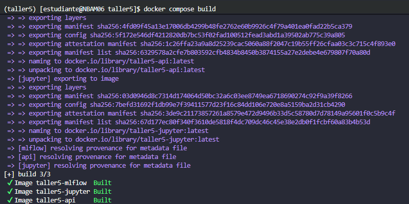

Levantar servicios:

```bash
docker compose up -d
```

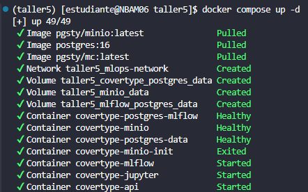

Consultar estado:

```bash
docker compose ps
```

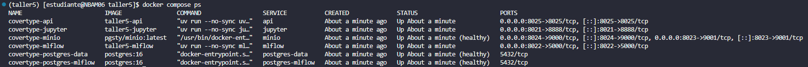

Validamos que el servicio de Minio-init haya creado el bucket:

```bash
docker compose logs minio-init
```

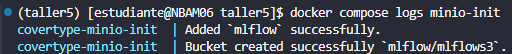

## 🌐 Acceso a servicios

```text
MLflow       http://localhost:8022
MinIO        http://localhost:8023
JupyterLab   http://localhost:8021
FastAPI      http://localhost:8025/docs
```

En un servidor remoto se debe reemplazar `localhost` por la IP o URL publicada por el entorno.


## 🛡️ Seguridad de MLflow

En entornos con IP, reverse proxy o port forwarding, MLflow puede bloquear solicitudes por validación de `Host` o CORS.

Se configuraron variables como:

```yaml
MLFLOW_SERVER_ALLOWED_HOSTS: >-
  mlflow:5000,
  localhost:*,
  <HOST_PUBLICO>

MLFLOW_SERVER_CORS_ALLOWED_ORIGINS: >-
  http://<HOST_PUBLICO>,
  http://localhost:5001
```

`MLFLOW_SERVER_ALLOWED_HOSTS` protege el encabezado `Host`, mientras que `MLFLOW_SERVER_CORS_ALLOWED_ORIGINS` controla los orígenes web permitidos.

## 📊 Notebook de entrenamiento y experimentación

Notebook principal:

```text
notebooks/01_training_experiments.ipynb
```

Flujo:

```text
covertype.csv
      ↓
validación inicial
      ↓
raw.covertype
      ↓
preprocesamiento
      ↓
processed.covertype
      ↓
train / test split
      ↓
20 experimentos MLflow
      ↓
comparación de métricas
      ↓
modelo ganador
      ↓
MLflow Model Registry
      ↓
alias champion
```

### 1. Lectura y validación

El notebook lee:

```text
/workspace/data/covertype.csv
```

Se valida:

- dataset no vacío;
- ausencia de columnas duplicadas;
- variable objetivo disponible;
- tipos de datos;
- distribución de clases.

Los nombres de columnas se normalizan a minúsculas y `snake_case`.

### 2. Persistencia RAW

Los datos originales se almacenan en:

```text
raw.covertype
```

Podemos validar mediante la interfaz realizando consultas con psql:

```bash
docker compose exec postgres-data psql -U covertype -d covertype
```

validamos que el esquema se hayan creado:

```bash
\dt raw.*
```

realizamos un conteo sobre la tabla:

```sql
SELECT COUNT(*) FROM raw.covertype;
```

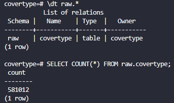

El esquema se crea automáticamente si no existe.

Para evitar superar el límite de parámetros de PostgreSQL/psycopg al usar `pandas.to_sql(..., method="multi")`, el `chunksize` se calcula dinámicamente:

```python
MAX_PARAMETERS = 60_000

chunksize = max(
    1,
    MAX_PARAMETERS // len(raw_db_df.columns),
)
```

Esto evita errores como:

```text
number of parameters must be between 0 and 65535
```

### 3. Preprocesamiento

El dataset procesado:

- elimina duplicados exactos;
- elimina registros sin variable objetivo;
- valida valores faltantes;
- separa variables numéricas y categóricas.

Variables categóricas identificadas:

```text
wilderness_area
soil_type
```

Estas variables no se codifican antes del `train_test_split`.

El encoding forma parte del `Pipeline` mediante:

```python
OneHotEncoder(
    handle_unknown="ignore",
    sparse_output=False,
)
```

De esta manera se evita fuga de información y la API utiliza exactamente el mismo preprocesamiento entrenado.

### 4. Persistencia PROCESSED

El resultado se almacena en:

```text
processed.covertype
```

De forma similar que en raw, podemos validar la tabla:

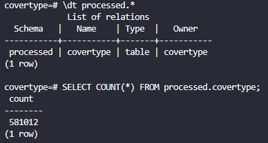

La base de datos mantiene así dos capas claramente separadas:

```text
raw.covertype
processed.covertype
```

### 5. Train/Test

La división utiliza:

```python
train_test_split(
    X,
    y,
    test_size=0.20,
    random_state=42,
    stratify=y,
)
```

`stratify=y` conserva la distribución de clases.

### 🧪 Experimentación con MLflow

El proyecto ejecuta **20 experimentos independientes en MLflow**.

No se modelaron como 20 runs dentro de un único experimento.

```text
MLflow
├── exp_01_...
│   └── run
├── exp_02_...
│   └── run
├── ...
└── exp_20_...
    └── run
```

Cada experimento representa una hipótesis o configuración distinta.

Debido a restricciones de memoria y almacenamiento encontradas durante el desarrollo, se priorizaron variaciones de `DecisionTreeClassifier`, cuyos modelos son considerablemente más pequeños que ensembles como `RandomForestClassifier`.

Entre los hiperparámetros explorados se encuentran:

```text
max_depth
min_samples_leaf
min_samples_split
criterion
max_features
class_weight
```

Ejemplos de configuraciones:

```text
dt_baseline
dt_depth_5
dt_depth_8
dt_depth_10
dt_depth_12
dt_depth_15
dt_depth_20
dt_depth_25
dt_leaf_2
dt_leaf_5
dt_leaf_10
dt_split_5
dt_split_20
dt_entropy_depth_12
dt_entropy_depth_20
dt_log_loss
dt_features_sqrt
dt_balanced
```
Si entramos a la interfaz de Mlflow podemos ver como cada uno de los experimentos es registrado:

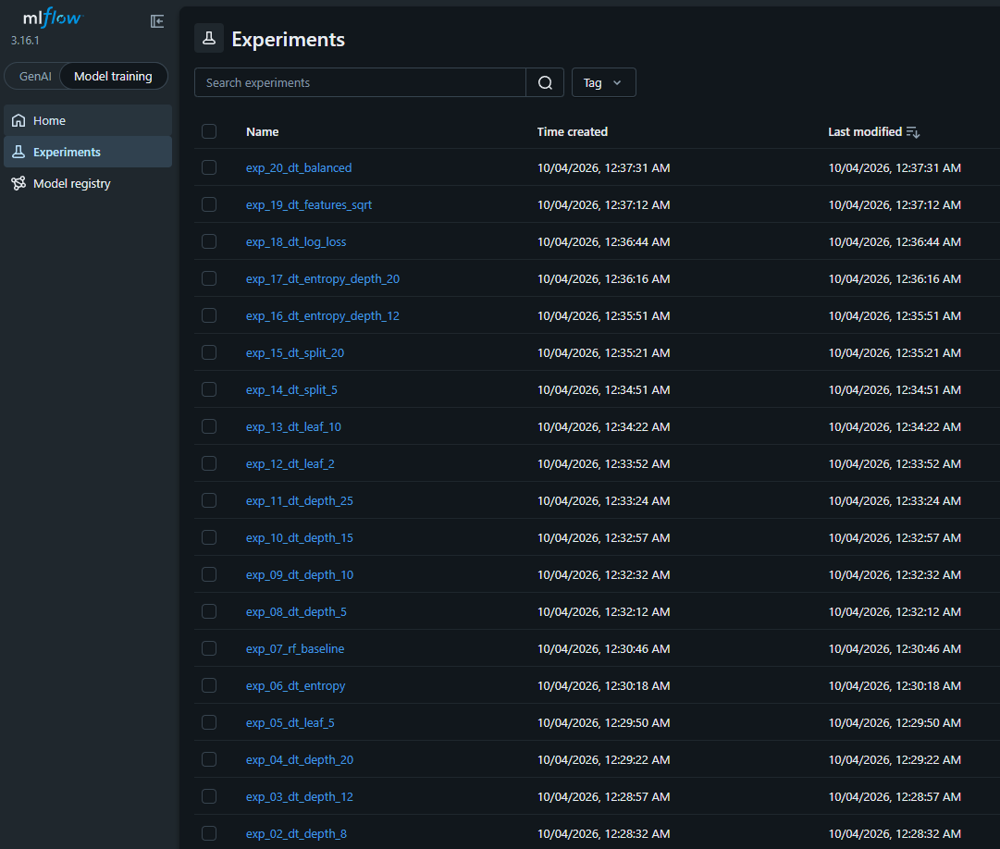


### 📈 Métricas

Cada experimento registra:

```text
accuracy
balanced_accuracy
precision_macro
recall_macro
f1_macro
f1_weighted
```

La selección del mejor modelo utiliza principalmente:

```text
f1_macro
```

con `balanced_accuracy` como criterio secundario.

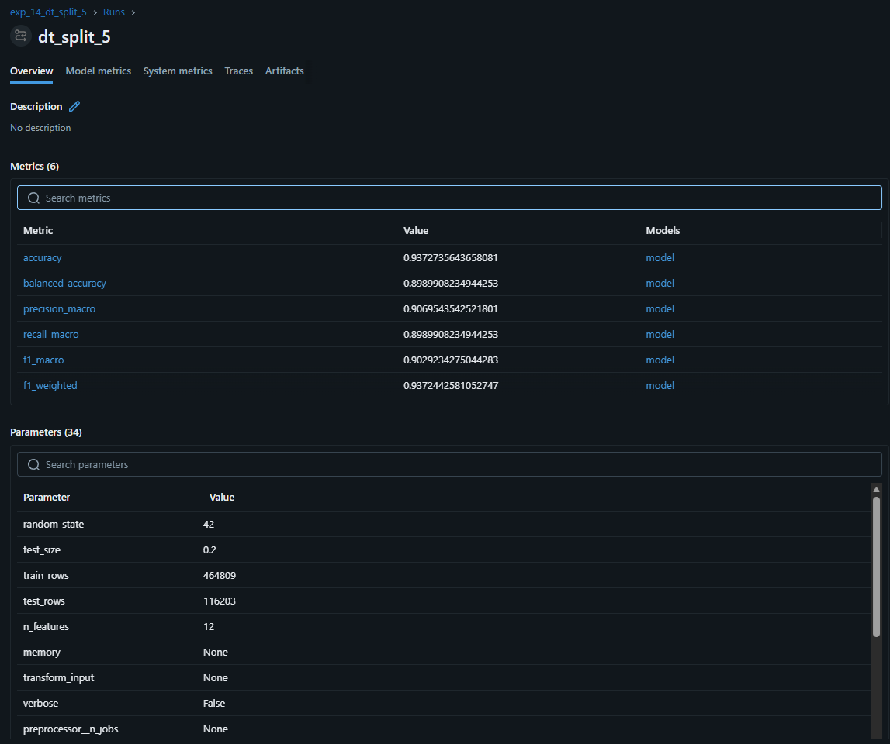

### 📁 Artefactos

Cada experimento registra, además de métricas y parámetros:

```text
classification_report.json
confusion_matrix.png
modelo serializado
```

Para modelos basados en árboles, `skops` requiere declarar explícitamente como confiable el tipo interno de árbol:

```python
SKOPS_TRUSTED_TYPES = [
    "sklearn.tree._tree.Tree",
]
```

Registro del modelo:

```python
mlflow.sklearn.log_model(
    sk_model=estimator,
    name="model",
    input_example=X_train.head(5),
    skops_trusted_types=SKOPS_TRUSTED_TYPES,
)
```

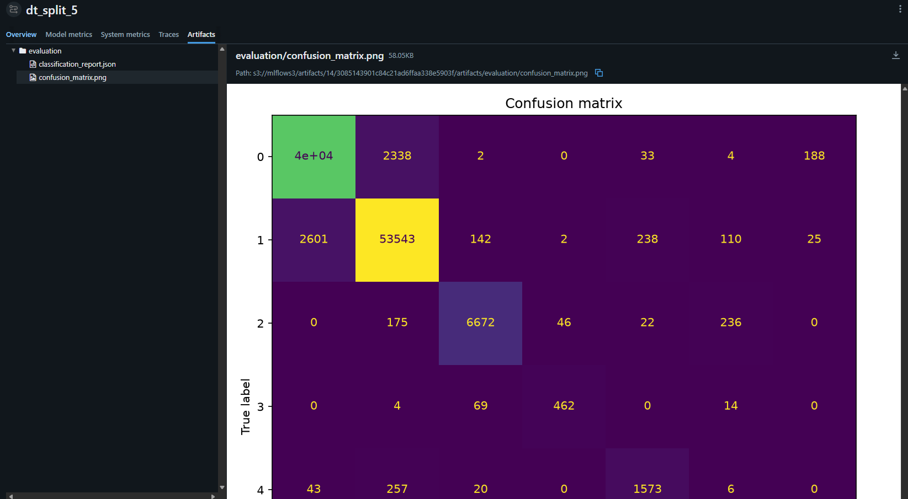


### 🪣 Artefactos en MinIO

Los artefactos se almacenan en:

```text
mlflows3/artifacts/
```

Como cada configuración se definió como un experimento independiente, MinIO refleja identificadores numéricos distintos:

```text
mlflows3/
└── artifacts/
    ├── 1/
    ├── 2/
    ├── 3/
    ├── ...
    └── 20/
```

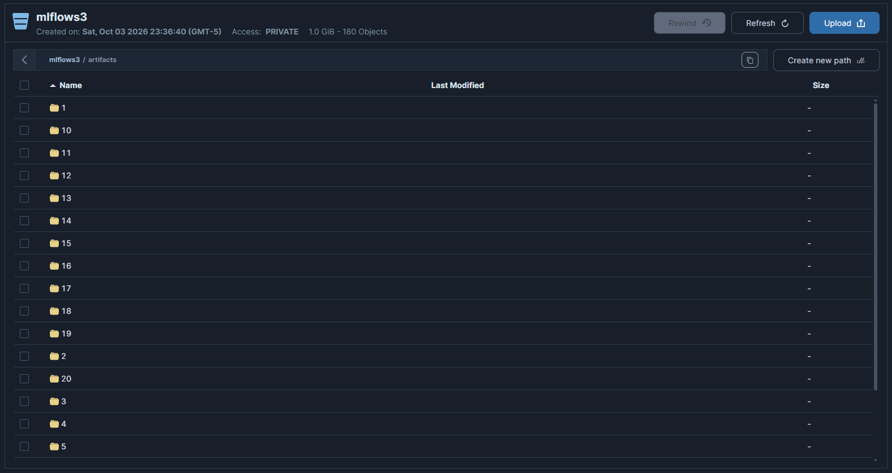

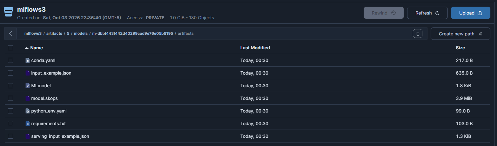


### 🏆 Model Registry

El modelo ganador se registra con el nombre:

```text
covertype_classifier
```

y recibe el alias:

```text
champion
```

URI utilizada por la API:

```text
models:/covertype_classifier@champion
```

La API queda desacoplada de:

```text
run_id
version
ruta MinIO
archivo físico
```

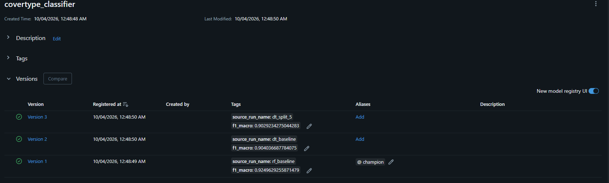


## 🚀 API de inferencia

Swagger:

```text
http://localhost:8025/docs
```

La API carga el modelo `champion` desde MLflow.

## GET `/`

Ejemplo:

```json
{
  "service": "Covertype ML API",
  "status": "running"
}
```

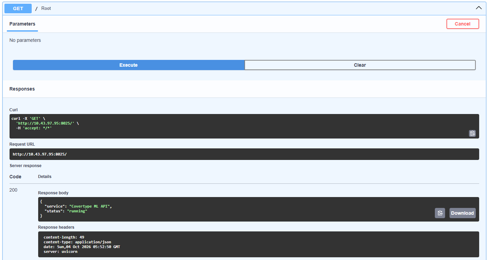

## GET `/health`

Ejemplo:

```json
{
  "status": "ok",
  "model_loaded": true
}
```

Si `model_loaded` es `false` después de registrar el modelo, se puede reiniciar únicamente la API:

```bash
docker compose restart api
```

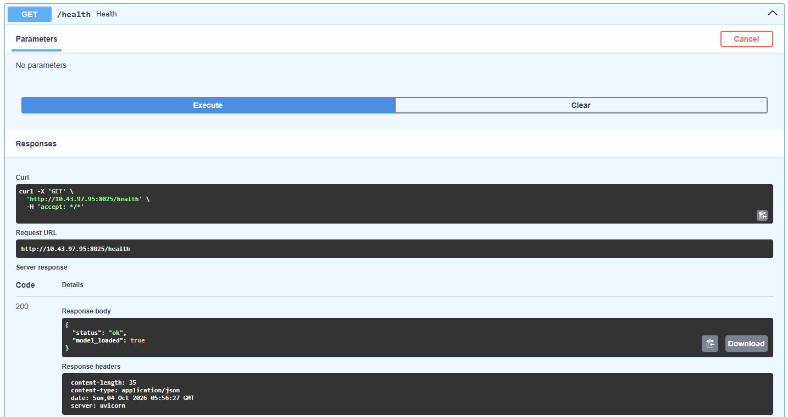

## GET `/model`

Ejemplo:

```json
{
  "model_name": "covertype_classifier",
  "model_alias": "champion"
}
```

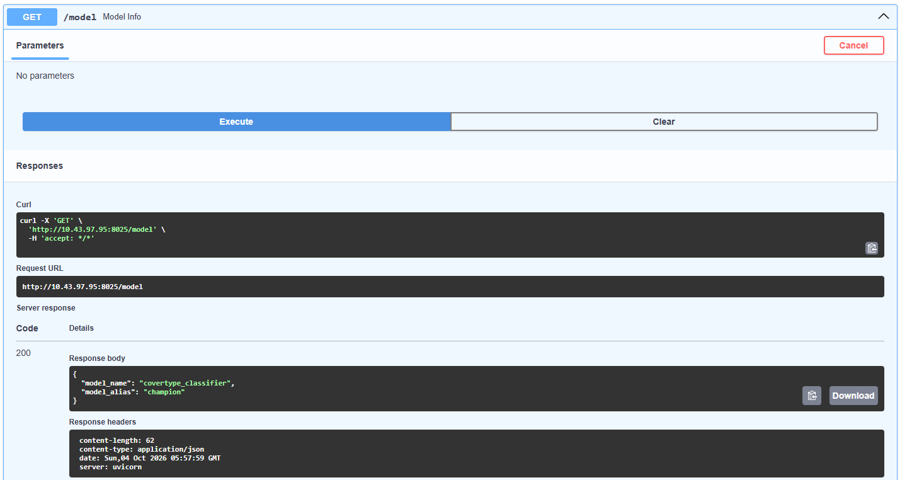

## POST `/predict`

El request utiliza un objeto `features` con todas las variables esperadas por el modelo.

Ejemplo conceptual:

```json
{
  "features": {
    "elevation": 2596,
    "aspect": 51,
    "slope": 3,
    "horizontal_distance_to_hydrology": 258,
    "wilderness_area": "Rawah",
    "soil_type": "C2702"
  }
}
```

Las variables categóricas se envían directamente como texto porque el `OneHotEncoder` está incluido dentro del `Pipeline` registrado.

Respuesta:

```json
{
  "prediction": 2,
  "model_name": "covertype_classifier",
  "model_alias": "champion"
}
```

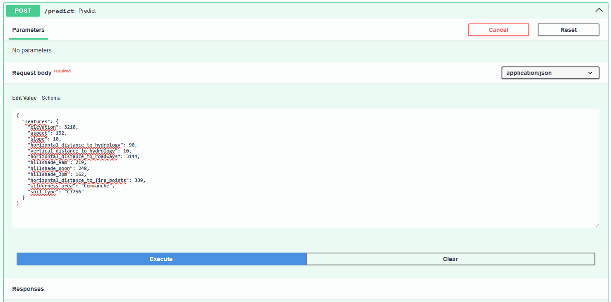
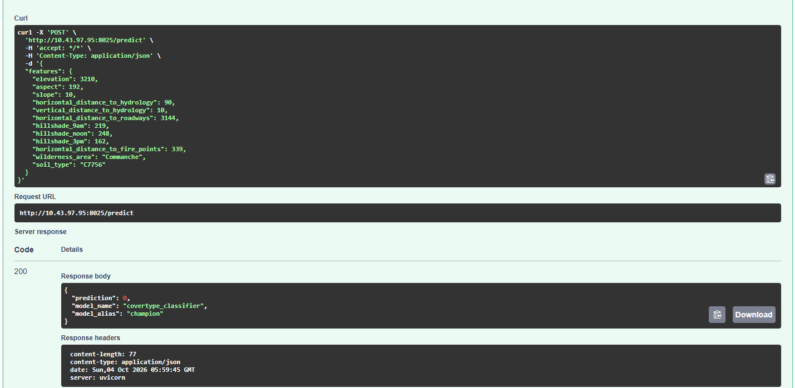


## 🎯 Resultado final

El proyecto implementa un flujo MLOps reproducible en el que:

- los datos se almacenan persistentemente en PostgreSQL;
- `raw` y `processed` permanecen separados;
- MLflow registra 20 experimentos independientes;
- MinIO almacena los artefactos y modelos;
- las transformaciones categóricas forman parte del `Pipeline`;
- el modelo ganador se registra en Model Registry;
- el alias `champion` desacopla la API de una versión específica;
- FastAPI realiza inferencia cargando el modelo desde MLflow;
- Docker Compose integra y reproduce toda la infraestructura.


## 🧠 Restricciones de recursos y ajustes realizados

Durante la experimentación se identificaron dos restricciones principales:

1. `RandomForest` con numerosos árboles podía agotar la memoria del kernel de Jupyter.
2. Los artefactos grandes podían llevar a MinIO al umbral mínimo de espacio libre.

Se presentó el error:

```text
XMinioStorageFull
Storage backend has reached its minimum free drive threshold
```

Ajustes realizados:

- reducción de modelos pesados;
- priorización de `DecisionTreeClassifier`;
- uso de `gc.collect()` después de experimentos cuando fue necesario;
- recreación del contenedor Jupyter para liberar su writable layer;
- limpieza de build cache;
- monitoreo del filesystem donde se encuentra `/var/lib/docker`.

Comandos útiles:

```bash
df -h
docker system df
docker system df -v
docker builder prune -a
```

No se recomienda durante el proyecto:

```bash
docker system prune -a --volumes
```

porque puede eliminar PostgreSQL y MinIO.